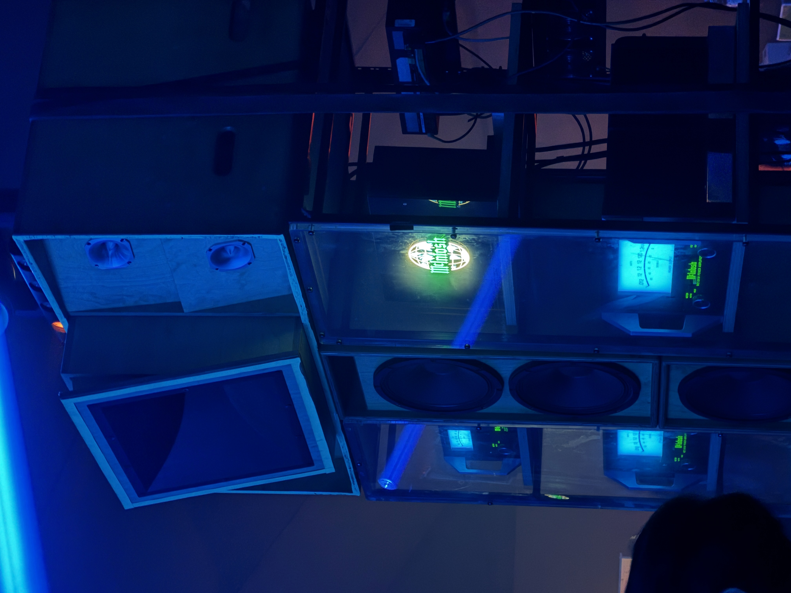

---
# Blog Type:
# Primarily written thoughts or stories.

# Key Info
title: Despacio
type: blog

# Describing Info
description: Dope disco tent.
created: 2026-10-05
tags: 
image: despacio.JPG
display_size: square
---

<iframe src="https://open.spotify.com/embed/track/5vdp5UmvTsnMEMESIF2Ym7?utm_source=generator" width="100%" height="152" style="border-radius: 12px; border: 0;" allow="autoplay; clipboard-write; encrypted-media; fullscreen; picture-in-picture" loading="lazy"></iframe>

Last Sunday I spontaneously went to San Francisco's Portola music festival with Vedant and Julia!

I had zero expectations or artists that I felt like I needed to see since I didn't even buy the tickets which made the experience very chill. It was cool to see some top DJs playing music I had never heard of. We saw Ben UFO and he was mixing up some crazy sounds.

The coolest part though was by far Despacio. I did not know anything about Despacio except for what Vedant had told me; "it's this big disco room where the DJs are off to the side and everyone is dancing to low RPM music with slow builds." Turns out this was very accurate but it was way cooler then that.

We walked in and the first thing I noticed was obviously the massive disco ball at the center of the room and the beams of light dancing around it. Throughout the night they continued to make new patterns and interact with the disco ball which ngl was very mesmerizing. The intention of the physical layout of Despacio, as I later learned, is to get people to face each instead of staring at the DJs (very awesome idea). This isn't quite what happened since everyone was just staring at the disco ball but I didn't mind.

It was a cool system, all of these lights were actuated on pan tilts and could point almost anywhere in the room as well as change colors and focal points (fully collimated vs diffuse).

After the disco ball and lights were the massive speakers surrounding the dance floor. There were seven sets of these tall stacks of speaker cabinets. 

They didn't look fancy, just bare plywood cabinets, but the amplifiers had blue illumated dials revealing the current power draw (no pun intended) of the speakers. Some research later revealed these were McIntosh amplifiers and a custom array of speakers designed by James Murphy of LCD Soundsystem, an audio engineer named John Klett, and David and Stephen Dewaele of Soulwax. The complete system is capable of 50,000 watts!!! Whaaaaattttt thats crazy.

So yeah apparently the speakers are very well designed and certain spots on the dancefloor have perfectly timed stereo sounds. Next time I will have to walk around more to find them!

The last cool thing was the music. James Murphy, David and Stephen Dewaele specifically play low rpm tracks straight from vinyl records. I thought that it was very awesome that at one of San Francisco's biggest music events of the year there is this little tent using vinyl records and playing old disco songs.

Anyways, I will definitely be attending if Despacio is back next year! It was a fun experience.
