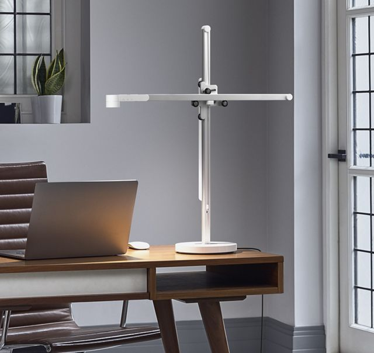

---
# Media Type:
# Movies, TV shows, songs, podcasts

# Key Info
title: The Open Task Light
type: media

# Describing Info
description: Thoughts on a cool open source engineering project.
created: 2026-10-05
tags: 
image: 
display_size: small-square

# Unique Info
creator: [Steven Bennett](https://www.youtube.com/@StevenBennettMakes)
status: Watched
---

## Thoughts

I have been watching Steven Bennett's videos on the (open task light project)[https://opentasklight.com/] for a while and just watched his concluding post on the project. Check it out here:

<iframe src="https://www.youtube-nocookie.com/embed/ipVFRH6TQfM" title="YouTube video" style="width: 100%; height: 100%; border: 0;" referrerpolicy="strict-origin-when-cross-origin" allow="accelerometer; autoplay; clipboard-write; encrypted-media; gyroscope; picture-in-picture; web-share" allowfullscreen></iframe>

What a crazy project! Six years engineering a desk lamp that Dyson actively sells.

I think this is a great example though of what makes mechanical engineering and good design so interesting. On the surface this lamp is elegant and simple. You can twist the light, position it's height and cantilever offset, and of course change the brightness, 

But dive deeper, as Steven did, into the work that goes into making it this simple and you reveal layers upon layers of complex technical challenges that had to be solved to make the beautiful simplicity work.

How did the structure sink the heat from the LED? How did the LED receive power despite no cables being visible? How did the structure allow for three degrees of freedom while being rigid and reliable?

I also really enjoyed hearing Steven's reflections on his experience working on the project. I can definitely relate to him talking about the flow state you can get into when working on challenges like these. It requires a combination of technical knowledge, creativity, and persistence to execute a project like this!

Now that I have graduated school (for good this time I think) I aspire to execute projects like this. Although it has only been a couple months of my first job, I am definitely finding it difficult to be productive with personal projects outside of work. It's very easy to get home after work and just relax, and on weekends there are so many things to do!

A couple ideas I have right now:
- Adding GaggiaMate to espresso machine
- A custom wire frame japenese paper lamp shade
- Stenciled / painted posters instead of just on my laptop
- Design / control of an autonomous vehicle
- Finishing Ben and I's PCB drone (see I have execution problems)
- Custom speakers??? [Inspired by Despacio](../../blog/despacio/index.html)

As a side note, I am very much an appreciator of good lighting design and I was definitely watching Steven Bennett's videos when I decided to make my first lamp (link here). Hopefully there are more to come!
